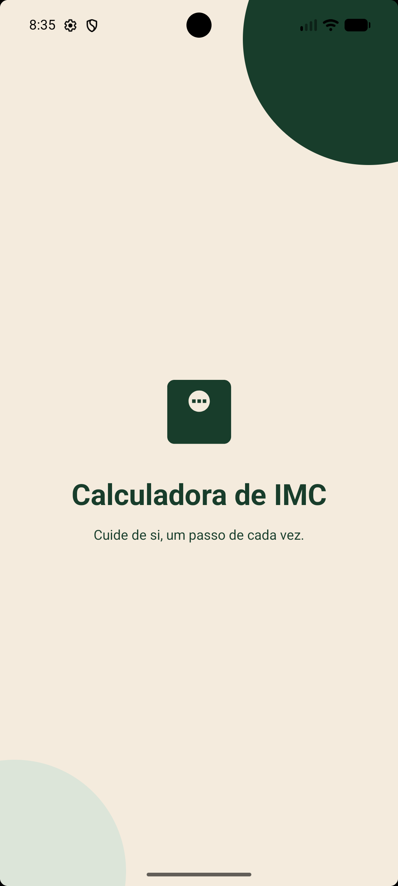
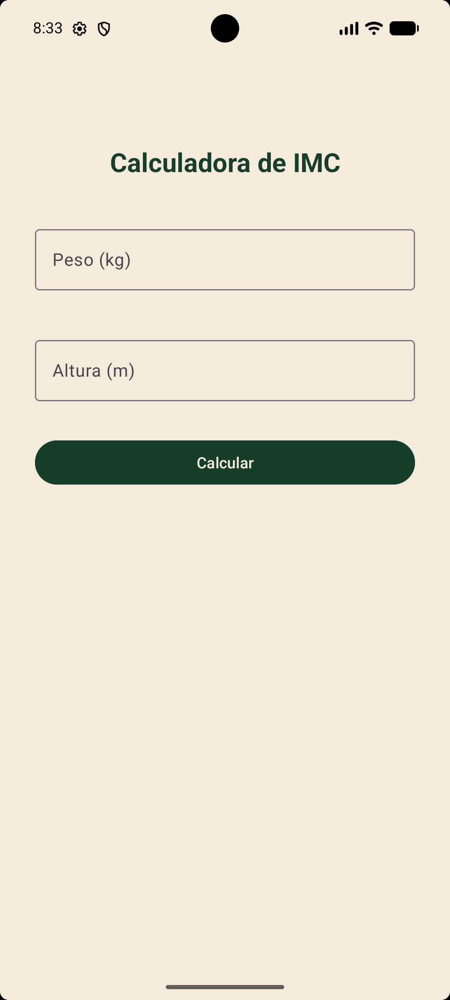
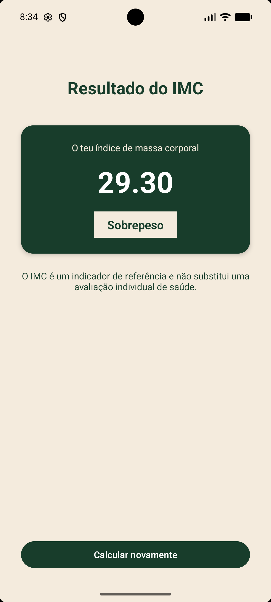

# Calculadora de IMC

Aplicação Android desenvolvida em **Kotlin** para calcular o Índice de Massa Corporal (IMC) a partir do peso e da altura do utilizador.

Este projeto foi desenvolvido como parte do meu percurso de aprendizagem em desenvolvimento Android, com foco na construção de interfaces, lógica de programação e comunicação entre Activities.

## 📱 Screenshots
### Splash Screen

### Calculadora

### Resultado

## ✨ Funcionalidades

- Introdução do peso e da altura.
- Cálculo automático do IMC.
- Apresentação do resultado com duas casas decimais.
- Classificação do IMC por intervalos.
- Opção para calcular novamente, limpando os campos.
- Ecrã inicial (Splash Screen) com duração de 2 segundos.
- Interface personalizada com uma paleta de verde-floresta e creme.

## 🛠️ Tecnologias utilizadas

- Kotlin
- Android Studio
- XML para construção das interfaces
- Android Activities e Intents

## 📚 Conceitos praticados

- Acesso aos elementos da interface com `findViewById`.
- Eventos de clique com `setOnClickListener`.
- Validação e conversão de dados.
- Cálculos matemáticos e estruturas condicionais `when`.
- Passagem de dados entre Activities através de `Intent`.
- Formatação numérica com duas casas decimais.
- Ciclo de vida de uma Activity.

## 🚀 Como executar o projeto

1. Clona ou descarrega este repositório.
2. Abre o projeto no Android Studio.
3. Aguarda a sincronização do Gradle.
4. Executa a aplicação num emulador ou dispositivo Android compatível.

---

Projeto desenvolvido para praticar desenvolvimento Android com Kotlin.
